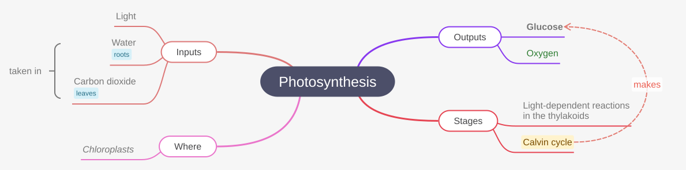
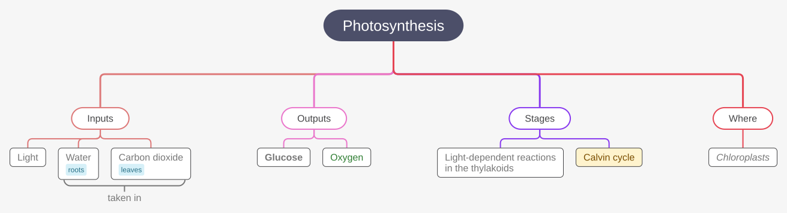
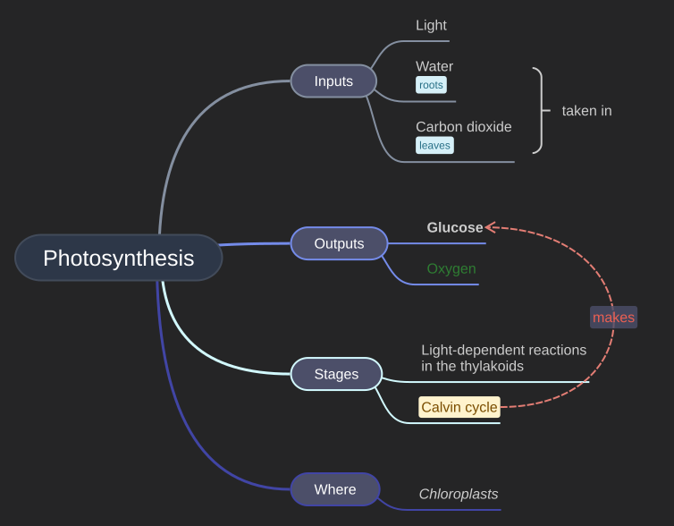

# mind-elixir-export-svg

Render [Mind Elixir](https://github.com/SSShooter/mind-elixir-core) mind maps as standalone SVG
that looks like the editor: vector shapes, native `<text>`, Mind Elixir's own layout. It works
from the map's data alone, like [Pele](https://github.com/obsidianmd/pele) does for Mermaid: no
browser, no DOM, the same SVG in a browser, Node, Bun or a worker.

```ts
import { renderSvg } from "@erseco/mind-elixir-export-svg";

const { svg, width, height, warnings } = await renderSvg(mind.getData());
// or renderSvg(mind): an instance's data, theme and direction
```

- **Mind Elixir's layout, computed.** Topic sizes, line breaks, gaps, branch curves, arrows and
  summary brackets follow Mind Elixir 5.15.1's stylesheet and connector code, with Arial's
  advance widths and kerning. For text in Arial the result is where Mind Elixir draws it in
  Chromium and WebKit, to a few hundredths of a pixel (measured below).
- **Native SVG only.** Rects, paths, `<text>`/`<tspan>` and, for pictures in the map, `<image>`.
  No `foreignObject`, no screenshot, no stylesheet, no script, no network.
- **Deterministic and portable.** One way to calculate, from font metrics tables (no canvas), so
  an export made on a server matches one made in the editor.
- **Safe with hostile maps.** Data is validated, captions are escaped text, links and images are
  allow-listed, sizes are limited, and problems are typed errors or warnings.

## Examples

The same map in Mind Elixir and as the SVG this package makes from its data
(`npm run screenshots` regenerates them):

| Mind Elixir 5.15.1 (Chromium screenshot)                    | `renderSvg(mind)`                             |
| ----------------------------------------------------------- | --------------------------------------------- |
|  |  |

Styles, tags, a summary and an arrow with its label, both sides. More SVGs, as GitHub draws them:

**Top-down** (`direction: 3`)



**Dark theme**, one side (`theme: DARK_THEME`, `direction: 1`)



## Why not the alternatives

|                                 | PNG screenshot        | Mermaid + Pele     | This package       |
| ------------------------------- | --------------------- | ------------------ | ------------------ |
| Vector shapes, selectable text  | No                    | Yes                | Yes                |
| Mind Elixir's own layout        | A picture of it       | No, Mermaid's      | Yes                |
| Colours, sizes, styles per node | Captured              | Bold and italic    | Yes                |
| Arrows, summaries, tags, images | Captured              | No                 | Yes                |
| Without a browser               | No                    | Yes                | Yes                |
| Size, 311-node map              | 1,393,514 B (1.39 MB) | 128,543 B (129 kB) | 109,911 B (110 kB) |

Mind Elixir's own `exportSvg()` is deprecated: it needs the editor's DOM, puts captions in
`foreignObject` (which svg2pdf.js cannot draw), writes `width="auto"`, inserts captions as HTML
and leaves out arrow and summary labels
([#230](https://github.com/SSShooter/mind-elixir-core/issues/230),
[#359](https://github.com/SSShooter/mind-elixir-core/issues/359)).

## Install

```sh
npm install @erseco/mind-elixir-export-svg
```

It has no dependencies. It reads Mind Elixir data structurally, so it needs no Mind Elixir
package at runtime. The layout follows Mind Elixir 5.15.1
(`SUPPORTED_MIND_ELIXIR_VERSION`).

## Use

```ts
import { renderSvg, exportSvg, downloadSvg, toDataUrl, DARK_THEME } from "@erseco/mind-elixir-export-svg";

const result = await renderSvg(data, { padding: 24, title: "Photosynthesis" });
result.svg; // '<svg xmlns="http://www.w3.org/2000/svg" width="733.08" height="101" ...'
result.warnings; // [{ code: "IMAGE_NOT_EMBEDDED", message: "...", nodeId: "a1" }]

await renderSvg(data, { theme: DARK_THEME, direction: 3 }); // top-down, dark
const blob = await exportSvg(data); // image/svg+xml;charset=utf-8
await downloadSvg(mind, "photosynthesis.svg"); // in a browser
img.src = toDataUrl(result.svg); // data:image/svg+xml;base64,...
```

As a Mind Elixir plugin, it adds `mind.exportVectorSvg()` (Mind Elixir's deprecated `exportSvg`
is left alone):

```ts
import { createSvgExportPlugin, type WithVectorSvgExport } from "@erseco/mind-elixir-export-svg";

mind.install(createSvgExportPlugin({ background: "transparent" }));
const { svg } = await (mind as WithVectorSvgExport<typeof mind>).exportVectorSvg();
```

Without an explicit `theme`, the plugin reads the container's computed CSS variables and uses one
when it differs from the declared theme (a page override, a partial theme, compact gaps).
`renderSvg` itself does not read the page. A transparent background stays transparent.

### Options

| Option                 | Default            |                                                                                                                                         |
| ---------------------- | ------------------ | --------------------------------------------------------------------------------------------------------------------------------------- |
| `padding`              | `24`               | Space around the map, in px.                                                                                                            |
| `background`           | `"theme"`          | The theme's `--bgcolor`; `"transparent"`; or `#hex`, `rgb()`, `rgba()`, a colour name.                                                  |
| `title`, `description` | root topic, none   | The SVG's `<title>` and `<desc>`.                                                                                                       |
| `idPrefix`             | `"mindmap-svg"`    | Prefix of the ids in the SVG; give each map on a page its own.                                                                          |
| `theme`                | data's, else light | A Mind Elixir theme. `type: "dark"` fills gaps from `DARK_THEME`; `cssVar` may be partial. `compact` on the data sets the compact gaps. |
| `direction`            | data's, else `2`   | 0 left, 1 right, 2 both sides, 3 top-down.                                                                                              |
| `fontFamily`           | Arial stack        | The font family written into the SVG.                                                                                                   |
| `measureText`          | Arial              | `{ width(text, font), vertical }`: lay out for another font.                                                                            |
| `textLength`           | `true`             | Write each line's width as `textLength`, so a viewer with other fonts fits it.                                                          |
| `links`                | `"preserve"`       | Node links become SVG links (http, https, mailto); `"text"` keeps only the 🔗.                                                          |
| `embedImages`          | `true`             | Embed the map's images.                                                                                                                 |
| `resolveImage`         | none               | `(url, { signal }) => Blob \| dataURL \| null` for images that are not `data:` URLs.                                                    |
| `strict`               | `false`            | Throw instead of warning when something cannot be rendered faithfully.                                                                  |
| `signal`               | none               | An `AbortSignal` to cancel.                                                                                                             |
| `limits`               | see below          | `maxNodes` 10,000, `maxDepth` 1,000, `maxTextLength` 1,000,000, `maxImages` 200, `maxImageBytes` 5 MiB, `maxOutputLength` 50,000,000.   |

Errors are `SvgExportError` with a `code`: `INVALID_DATA`, `INVALID_OPTIONS`,
`INVALID_GEOMETRY`, `LIMIT_EXCEEDED`, `ABORTED`, or, in strict mode, the warning's code.
Warnings (`{ code, message, nodeId }`): `IMAGE_NOT_EMBEDDED`, `UNSUPPORTED_HTML` (custom HTML is
not laid out), `UNSUPPORTED_STYLE` (a colour or background it cannot draw), `UNSAFE_LINK`.

## The font

The layout is computed for **Arial**, from Arimo's advance widths and kerning (Arimo is
metric-compatible with Arial), and the SVG names `Arial, Helvetica, 'Liberation Sans', Arimo,
sans-serif`, which have those widths. To make the editor and the SVG match, set Mind Elixir's
font to Arial too:

```css
.map-container {
  font-family: Arial, Helvetica, "Liberation Sans", Arimo, sans-serif;
}
```

With Mind Elixir's default system font the SVG has the same layout, drawn in Arial. Emoji, CJK
and scripts Arial lacks are estimated (their widths depend on the viewer's fallback fonts), and
`textLength` keeps every line inside its node whatever font a viewer has. For another font, pass
a `measureText` with its metrics and a matching `fontFamily`.

## What is drawn

Topics (root, main and sub, with background, border, radius, padding, font size, weight, style
and colour), branch lines in the palette or `branchColor`, tags, icons, the link 🔗, images,
the folded-branch icon, arrows (curve, heads, dashes, colours, labels), summaries (brackets,
labels), and the theme's background. Left, right, both sides and top-down layouts. Folded
branches are drawn folded.

Not drawn, with a warning: the content of custom HTML nodes (`dangerouslySetInnerHTML`),
colours CSS can express but this cannot (gradients, `var()`). Underline and strike-through from
a node's style are not drawn, because Mind Elixir 5.15.1 does not display them either (they do
not reach the caption, which is an inline block).

## Accuracy

`npm run compare-layout` lays the test maps out and compares every topic with where Mind Elixir
draws it, with Arial ([docs/COMPATIBILITY.md](docs/COMPATIBILITY.md)). Largest difference of
any topic:

| Map                                          | Chromium 156                        | WebKit 27.2 | Firefox 157                           |
| -------------------------------------------- | ----------------------------------- | ----------- | ------------------------------------- |
| Text in Arial (3 to 311 topics, all layouts) | ≤ 0.03 px (0.27 px, 27 levels deep) | the same    | x ≤ 0.07 px; y drifts 1.5 px per line |
| With emoji, CJK, Hebrew, Arabic              | ≤ 10.5 px                           | ≤ 10.5 px   | ≤ 14 px                               |

Firefox sets `line-height: normal` taller than Chromium and WebKit (19.5 px for 16 px Arial, not
18). The layout follows Chromium and WebKit.

## Security

Map data is untrusted: it is validated iteratively (no recursion on its depth), captions are
escaped text, links are limited to http, https and mailto, images are embedded only from
`data:` URLs or your resolver (or `blob:` in a browser), after their bytes are checked to be PNG,
JPEG, GIF, WebP or AVIF, and every number is checked to be finite. Nothing is fetched. See
[SECURITY.md](SECURITY.md).

## Performance

`npm run bench` (Node 26 for the SVG; the PNG in Chromium 156 from the editor; median of 7):

| Map                 | SVG                | gzip             | Render | PNG (modern-screenshot) | Render   | Mermaid source   | Pele's SVG of it   |
| ------------------- | ------------------ | ---------------- | ------ | ----------------------- | -------- | ---------------- | ------------------ |
| 3 nodes             | 1,500 B (1.5 kB)   | 563 B            | 0.2 ms | 19,046 B (19 kB)        | 8.0 ms   | 84 B             | 2,002 B (2.0 kB)   |
| 16 nodes (13 shown) | 6,023 B (6.0 kB)   | 1,501 B (1.5 kB) | 0.4 ms | 94,735 B (95 kB)        | 24.4 ms  | 516 B            | 6,826 B (6.8 kB)   |
| 311 nodes           | 109,911 B (110 kB) | 6,569 B (6.6 kB) | 5.8 ms | 1,393,514 B (1.39 MB)   | 349.7 ms | 8,884 B (8.9 kB) | 128,543 B (129 kB) |

## Using it in eXeLearning

eXeLearning's mind map editor saves each map as this SVG, in an ``, next to the map's JSON
([docs/EXELEARNING.md](docs/EXELEARNING.md)).

## Development

```sh
npm ci
npx playwright install chromium firefox webkit
npm run check           # format, types, unit tests (100% coverage), build
npm run test:e2e        # against real Mind Elixir in Chromium, Firefox and WebKit
npm run test:package    # pack, install in an empty project, render from it in Node
npm run compare-layout  # docs/layout-deviation.json, for the pinned Mind Elixir
npm run test:compat -- --mind-elixir-version 5.15.1   # or latest, or next
npm run bench           # docs/benchmarks.json
npm run demo            # http://127.0.0.1:5173: the editor next to its export
```

`test:compat` installs the requested Mind Elixir beside the repo and writes
`artifacts/compat/`. `latest` means the newest stable release. How to read the report, and how to
adapt the layout when Mind Elixir changes, is in [docs/COMPATIBILITY.md](docs/COMPATIBILITY.md).

See [CONTRIBUTING.md](CONTRIBUTING.md), [AGENTS.md](AGENTS.md) and
[docs/ARCHITECTURE.md](docs/ARCHITECTURE.md).

## License

MIT. The layout constants, connector formulas, themes and expand icon follow Mind Elixir (MIT,
© 2019 DjZhou). Font metrics are from Arimo (SIL OFL 1.1, © 2020 The Arimo Project Authors).
